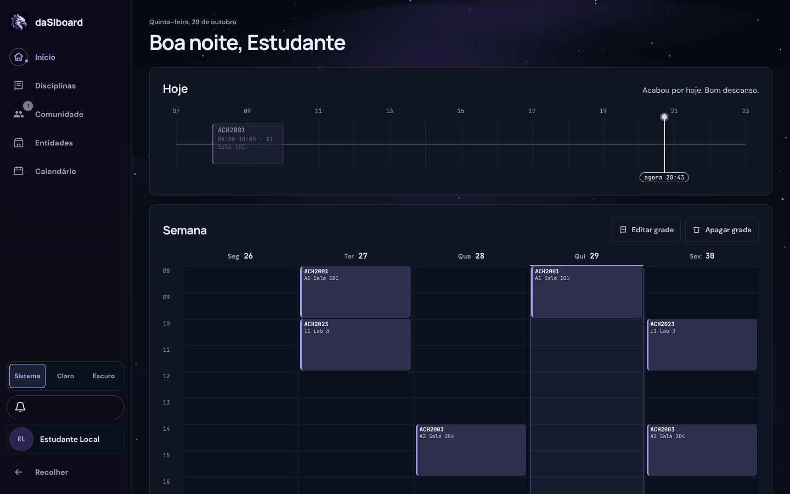
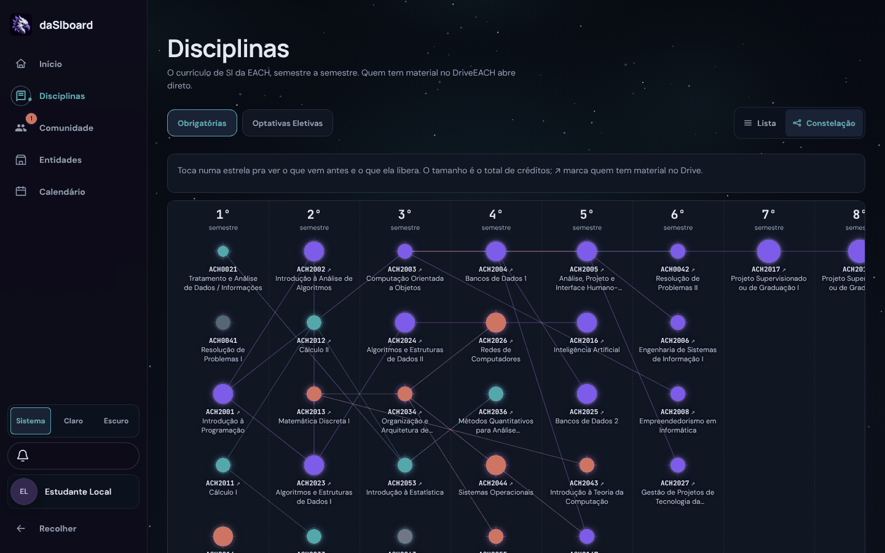
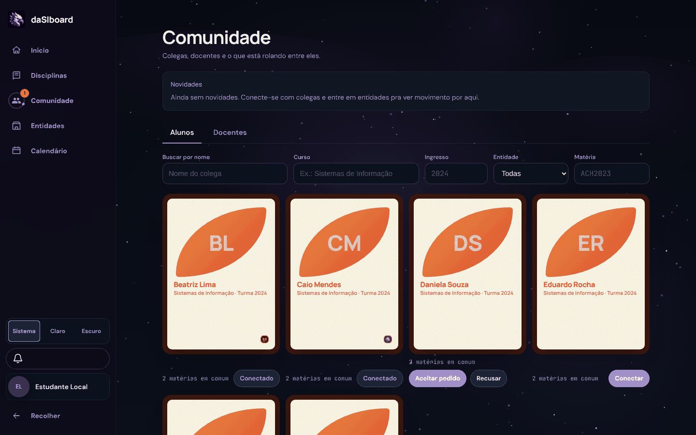
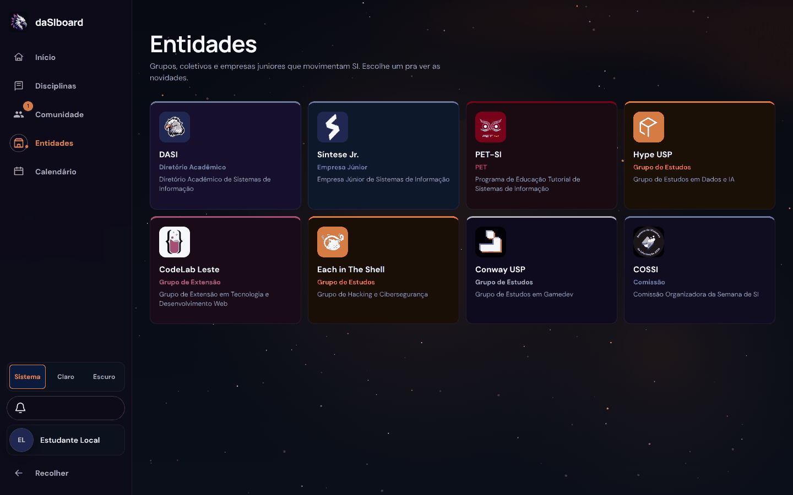
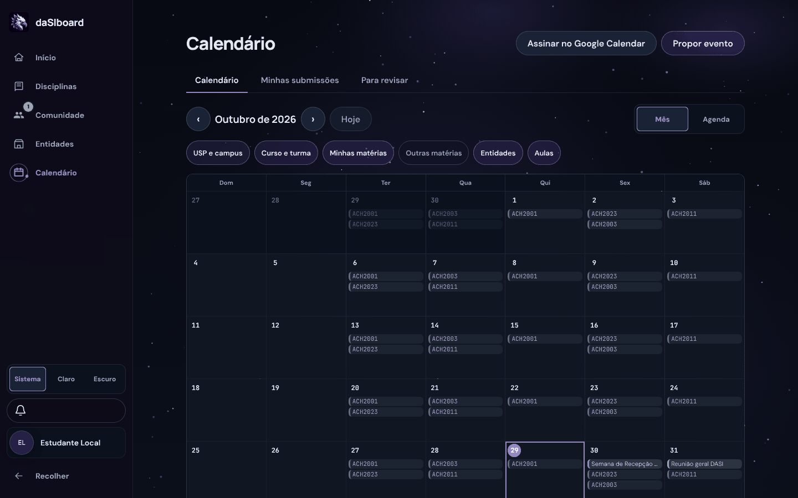
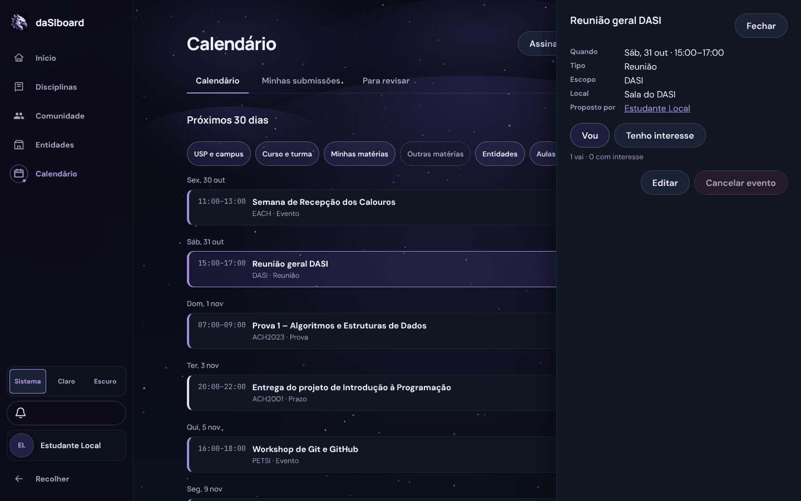
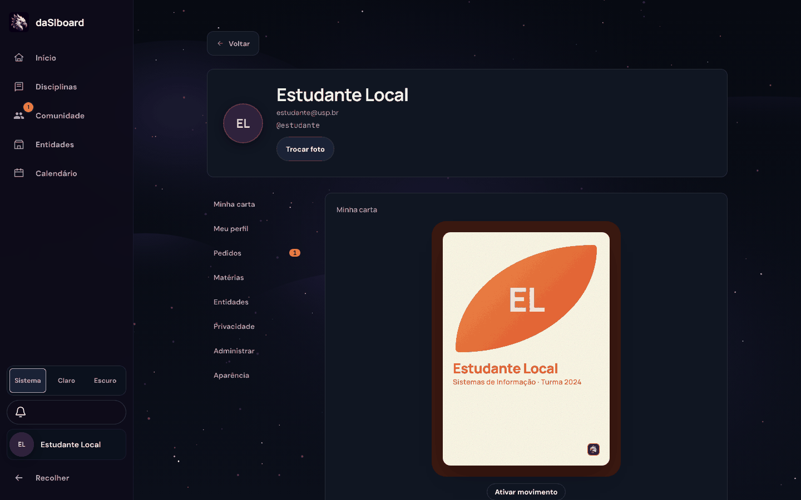
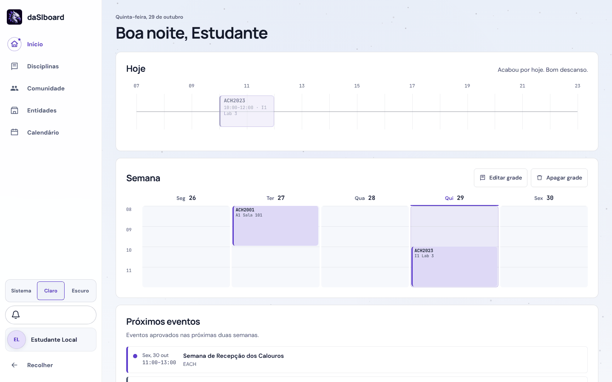
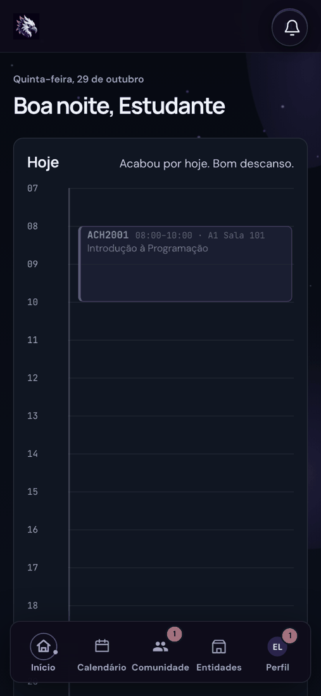
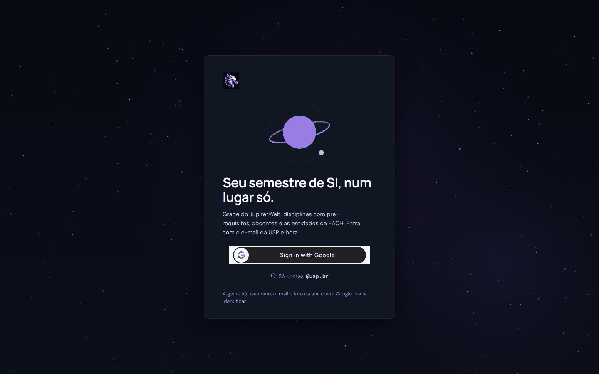

# daSIboard 🚀

[](https://dasiboard.vercel.app)




O **daSIboard** é a plataforma dos alunos de Sistemas de Informação da EACH-USP: reúne a **grade horária** (a partir do JupiterWeb), o **currículo** com pré-requisitos, a **comunidade** de colegas e docentes, as **entidades** estudantis e um **calendário** colaborativo de eventos, provas e prazos. O login é feito só com contas `@usp.br`.

> Todos os prints abaixo foram tirados do app rodando localmente com dados fictícios (veja [Dados de demonstração](#dados-de-demonstração-para-desenvolvimento-local)). O app em produção está em <https://dasiboard.vercel.app>.

## 🖼 Visão geral

### Início: o dia e a semana num relance

A tela inicial mostra a linha do tempo de **hoje** (com o marcador "agora"), a **semana** completa e os próximos eventos aprovados. A grade é montada informando os códigos das disciplinas e escolhendo as turmas, e pode ser editada depois sem apagar tudo.


### Disciplinas: o currículo como constelação

O currículo de SI semestre a semestre, em **lista** ou em **constelação**: toque numa estrela para ver o que vem antes e o que ela libera. Há abas para obrigatórias e optativas eletivas, e as matérias com material no DriveEACH ganham uma marca.



### Comunidade: colegas, docentes e cartas

Busca de alunos por nome, curso, ingresso, entidade ou matéria, com as **matérias em comum** e o fluxo de conexão (conectar, aceitar ou recusar pedidos). Cada aluno tem uma **carta** colecionável, com QR code e link público (`/c/<handle>`).



### Entidades

DASI, Síntese Jr., PET-SI, Hype USP, CodeLab Leste, Each in The Shell, Conway USP e COSSI, com avisos, membros, cargos, badges e códigos de convite gerados pelos admins de cada entidade.



### Calendário

Visão de **mês** ou **agenda** (próximos 30 dias), com filtros (USP e campus, curso e turma, minhas matérias, entidades, aulas). Qualquer aluno pode **propor eventos**, que passam por uma fila de revisão; dá para marcar **Vou** e **Tenho interesse** e **assinar o calendário no Google Calendar** por um link secreto pessoal (feed `.ics`).

| Mês | Detalhe do evento |
| --- | --- |
|  |  |

### Perfil, tema claro e celular

O perfil concentra a carta, dados pessoais, matérias, entidades, privacidade e aparência. O tema segue o sistema ou pode ser fixado em claro/escuro, e a interface é responsiva, com barra de navegação inferior no celular.

| Perfil | Tema claro | Celular |
| --- | --- | --- |
|  |  |  |

### Entrar



## ✨ Principais funcionalidades

*   **Login com Google (`@usp.br`)**: sessão por cookie assinado (JWT) e renovação automática.
*   **Grade horária (JupiterWeb)**: o aluno informa os códigos das disciplinas e escolhe as turmas; os horários vêm da consulta pública do JupiterWeb (`obterTurma`), sem pedir número USP nem senha.
*   **Currículo interativo**: pré-requisitos e disciplinas liberadas, em lista ou constelação, e atalho para colegas da mesma matéria.
*   **Comunidade**: perfis, conexões, privacidade por campo, feed de novidades e lista de docentes.
*   **Carta e coleção**: carta pública personalizável (QR code, exportação em imagem) e coleção de cartas de colegas.
*   **Entidades**: membros, cargos, badges, avisos e códigos de convite (guardados só como hash).
*   **Calendário colaborativo**: propostas com revisão, denúncias, "Vou" / "Tenho interesse" e feed `.ics`.
*   **Notificações**: central dentro do app e push no navegador (opcional, com chaves VAPID).
*   **Onboarding, temas e responsividade**: introdução em 4 passos, tema claro/escuro e navegação adaptada ao celular.

## 🛠 Tecnologias Utilizadas

### Frontend
*   **[React 19](https://react.dev/)** + **[React Router 7](https://reactrouter.com/)**
*   **[TypeScript](https://www.typescriptlang.org/)**
*   **[Vite](https://vite.dev/)** para desenvolvimento e build
*   `html-to-image` (exportar a carta) e `qrcode-generator` (QR da carta)

### Backend & API
*   **[Express 5](https://expressjs.com/)** (`server/`), publicado na Vercel como função serverless por `api/index.ts`.
*   **Autenticação**: Google Identity Services + `google-auth-library` e sessão com `jose`.
*   **Push**: `web-push` e service worker (`public/sw.js`).

### Banco de Dados
*   **[Supabase](https://supabase.com/)** (PostgreSQL + Storage para avatares), com RLS ligado e acesso só pelo servidor via `service_role`. Esquema em `supabase/schema.sql`.

### Qualidade
*   **[Vitest](https://vitest.dev/)** + Testing Library + Supertest (front e servidor).
*   **[Oxlint](https://oxc.rs/docs/guide/usage/linter.html)** (`.oxlintrc.json`).

## 🚀 Como rodar localmente

Requisitos: Node.js 20.19+ (ou 22.12+) e um projeto Supabase (de desenvolvimento) com o `supabase/schema.sql` aplicado.

```bash
npm install
```

Crie um `.env` na raiz (veja as variáveis nas seções abaixo): no mínimo `VITE_GOOGLE_CLIENT_ID`, `GOOGLE_CLIENT_ID`, `SESSION_SECRET` (32+ caracteres), `SUPABASE_URL` e `SUPABASE_SERVICE_ROLE_KEY`. Depois, em dois terminais:

```bash
npm run dev:server   # API Express em http://localhost:3000
npm run dev          # Vite em http://localhost:5173 (proxy de /api para a porta 3000)
```

### Scripts

| Script | O que faz |
| --- | --- |
| `npm run dev` | Frontend com Vite |
| `npm run dev:server` | API Express em modo watch |
| `npm run build` | Checagem de tipos + build de produção do frontend |
| `npm run build:server` | Compila o servidor para `dist-server/` |
| `npm run start:server` | Roda o servidor compilado |
| `npm run preview` | Serve o build do frontend |
| `npm test` | Testes (front em jsdom, servidor em node) |
| `npm run lint` | Oxlint |
| `npm run seed:dev` | Popula um Supabase de desenvolvimento com alunos fictícios |
| `npm run backfill:badges` | Recalcula badges de conquistas |
| `npm run gen:tech-icons` | Regenera `src/lib/techIcons.generated.ts` |

## 📁 Estrutura do Projeto

```text
dasiboard-omg/
├── api/                  # Entradas serverless da Vercel
│   ├── auth/             # google.ts, logout.ts, me.ts
│   ├── index.ts          # Reencaminha /api/* para o Express (server/index.ts)
│   └── schedule.ts
├── docs/
│   ├── plans/            # Planos e decisões de design de cada fase
│   └── screenshots/      # Prints usados neste README
├── public/               # Ícones, logos das entidades e service worker (sw.js)
├── server/               # API Express
│   ├── routes/           # Rotas: auth, schedule, social, entities, events, cards, push...
│   ├── social/           # Regras e acesso a dados do sistema social
│   ├── events/           # Regras, validação e feed .ics do calendário
│   ├── lib/              # Config, sessão, middlewares e rate limit
│   ├── scripts/          # seed:dev, backfill:badges, gen:tech-icons
│   └── test/             # Banco em memória e helpers dos testes
├── src/                  # Frontend React
│   ├── app/              # Rotas, layout e navegação
│   ├── auth/             # Login e contexto de sessão
│   ├── components/       # Sidebar, BottomNav, cartas, onboarding...
│   ├── features/         # home, disciplinas, comunidade, entidades, calendario,
│   │                     # notificacoes, perfil, carta
│   ├── lib/              # Clientes de API, storage, tema, push
│   └── styles/           # CSS por tela e tokens de design
├── supabase/             # schema.sql e migrations
├── vercel.json           # Rewrites e build na Vercel
└── vite.config.ts        # Vite + configuração do Vitest
```

## 🔐 Configuração do login Google

O botão de login usa o Google Identity Services no navegador. O valor de
`VITE_GOOGLE_CLIENT_ID` precisa ser um cliente OAuth do tipo **Aplicativo da Web**
e cada origem usada para abrir o app deve estar cadastrada no Google Cloud:

1. Acesse **Google Cloud Console → APIs e serviços → Credenciais**.
2. Abra o cliente OAuth correspondente ao `VITE_GOOGLE_CLIENT_ID`.
3. Em **Origens JavaScript autorizadas**, adicione as origens exatas, sem caminho
   ou barra final. Por exemplo:
   - `http://localhost:5173`
   - `http://127.0.0.1:5173` (se usado localmente)
   - `https://dasiboard.vercel.app`
   - `https://sieach.vercel.app`
   - `https://<seu-dominio.com>` (se houver outro domínio personalizado)
4. Salve, aguarde a propagação e faça um novo deploy/recarregamento.

O erro `400: origin_mismatch` ocorre antes de o pedido chegar ao servidor e
significa que a origem mostrada na barra do navegador não está nessa lista.
Não adicione caminhos como `/login`, nem use `*`. No Vercel, configure
`VITE_GOOGLE_CLIENT_ID` como variável de ambiente de **Build** e
`GOOGLE_CLIENT_ID`, `SESSION_SECRET`, `FRONTEND_URL` e as variáveis do Supabase
como variáveis de **Runtime**, usando `FRONTEND_URL` igual ao domínio público
principal (por exemplo, `https://dasiboard.vercel.app`). O backend já reconhece
`https://dasiboard.vercel.app` e `https://sieach.vercel.app`, além de reconhecer
automaticamente `VERCEL_URL` e `VERCEL_PROJECT_PRODUCTION_URL`. Se o projeto
usar mais de um domínio próprio, informe-os em `ALLOWED_ORIGINS`, separados por
vírgulas, por exemplo:

```text
ALLOWED_ORIGINS=https://app.exemplo.com,https://www.exemplo.com
```

Esses valores são normalizados para a origem (protocolo + host + porta), então
uma barra final em `FRONTEND_URL` não causa diferença.

Para o banco funcionar no deploy, configure no projeto da Vercel (em **Settings
→ Environment Variables**, para **Production** e **Preview**, se ambos forem
usados):

```text
SUPABASE_URL=https://<project-ref>.supabase.co
SUPABASE_SERVICE_ROLE_KEY=<service-role-key-do-Supabase>
```

`SUPABASE_SERVICE_ROLE_KEY` é uma variável somente de servidor: não use o
prefixo `VITE_` e não a exponha no frontend. Depois de salvar as variáveis, faça
um novo deploy. O esquema em [supabase/schema.sql](./supabase/schema.sql) também
precisa ter sido executado no projeto Supabase.

### Sistema social (Comunidade): variáveis de ambiente

As rotas sociais (`/api/me/*`, `/api/people`, `/api/connections`, `/api/feed`,
`/api/entities/*`, `/api/admin/*`) usam as variáveis abaixo, todas **somente de
servidor** (Runtime na Vercel, sem prefixo `VITE_`):

```text
INVITE_CODE_PEPPER=<texto aleatório com 32+ caracteres>
SUPERADMIN_EMAILS=voce@usp.br,outra.pessoa@usp.br
```

*   `INVITE_CODE_PEPPER` (**obrigatória em produção**, mínimo de 32 caracteres):
    segredo usado no HMAC-SHA256 dos códigos de convite das entidades. O banco
    guarda só o hash; o código em texto aparece uma única vez, para quem o gera.
    **Não troque depois de gerar códigos**: todos os códigos existentes deixariam de
    valer (basta gerar novos). Gere um valor com
    `node -e "console.log(require('crypto').randomBytes(32).toString('base64url'))"`.
    Fora de produção, se ausente, é derivada de `SESSION_SECRET` com um aviso.
    Sem ela em produção o servidor **não inicia**: configure antes do deploy.
*   `SUPERADMIN_EMAILS` (opcional): e-mails (separados por vírgula, sem distinção de
    maiúsculas) que podem gerar códigos e promover admins em qualquer entidade.
*   `DEV_FAKE_SESSION=1` (**apenas desenvolvimento**, veja abaixo). O servidor
    lança erro no boot se esta variável estiver ativa com `NODE_ENV=production` ou
    na Vercel. Nunca a configure na Vercel.

Roteamento na Vercel: `vercel.json` reescreve toda rota `/api/*` sem arquivo
próprio para a função `api/index.ts` (que importa `server/index.ts`), e o Express
roteia pelo caminho original. Só `/api/auth/*` e `/api/schedule` têm arquivos próprios. Não use `api/[...path].ts`: na
Vercel, fora do Next.js, ele só atende caminhos de um nível (`/api/people`, mas
não `/api/people/:handle`).
Antes do deploy, aplique `supabase/migrations/2026-10-20-social.sql` (veja
`supabase/README.md`).

### Dados de demonstração para desenvolvimento local

Sem uma sessão real do Google, as telas sociais ficariam vazias. Com um Supabase
**de desenvolvimento** configurado em `.env`:

```bash
npm run seed:dev                 # cria ~15 alunos fictícios @usp.br, conexões, pedidos e membros
DEV_FAKE_SESSION=1 npm run dev:server   # as requisições sem cookie viram o usuário estudante@usp.br
```

O script recusa rodar se `SUPABASE_URL` não parecer de desenvolvimento (aceita
`localhost` e hosts com rótulo `dev`, `staging`, `test`, `sandbox`, `local` ou
`preview`); para confirmar que o banco é de desenvolvimento, use
`SEED_DEV_CONFIRM=1 npm run seed:dev`. Ele também se recusa a rodar com
`NODE_ENV=production`. É idempotente e mexe só nos usuários fictícios e no usuário
de desenvolvimento. Ao final, imprime um código de convite de demonstração da
entidade Síntese Jr.

### Push no navegador

O push é opcional e fica desligado sem as chaves VAPID. Para ligar:

```bash
npx web-push generate-vapid-keys
```

Cadastre `VAPID_PUBLIC_KEY` e `VAPID_PRIVATE_KEY` (e, se quiser, `VAPID_SUBJECT`, por
padrão `mailto:` + o primeiro e-mail de `SUPERADMIN_EMAILS`) no `.env` e na Vercel. O
service worker (`public/sw.js`) só é registrado em produção ou com `VITE_ENABLE_SW=1`.

### Testes

`npm test` (ou `npx vitest run`) roda os testes do front-end (jsdom) e do servidor
(`server/**/*.test.ts`, ambiente node, Supabase substituído por uma camada de dados
em memória).

## 📜 Licença

O repositório ainda não tem um arquivo de licença.

